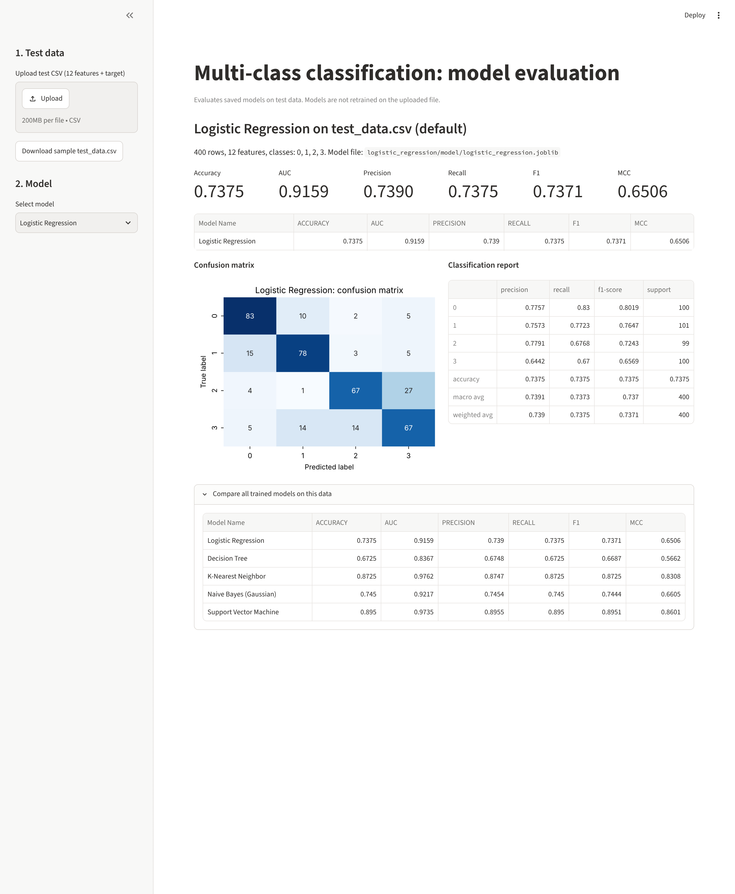
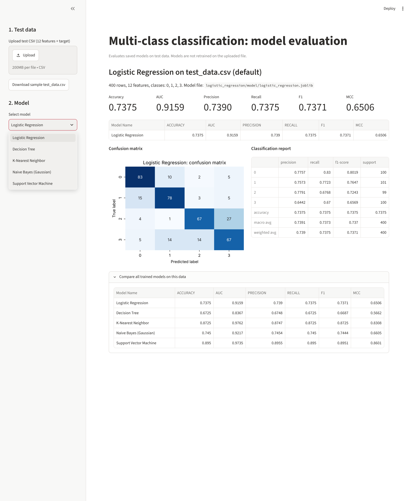
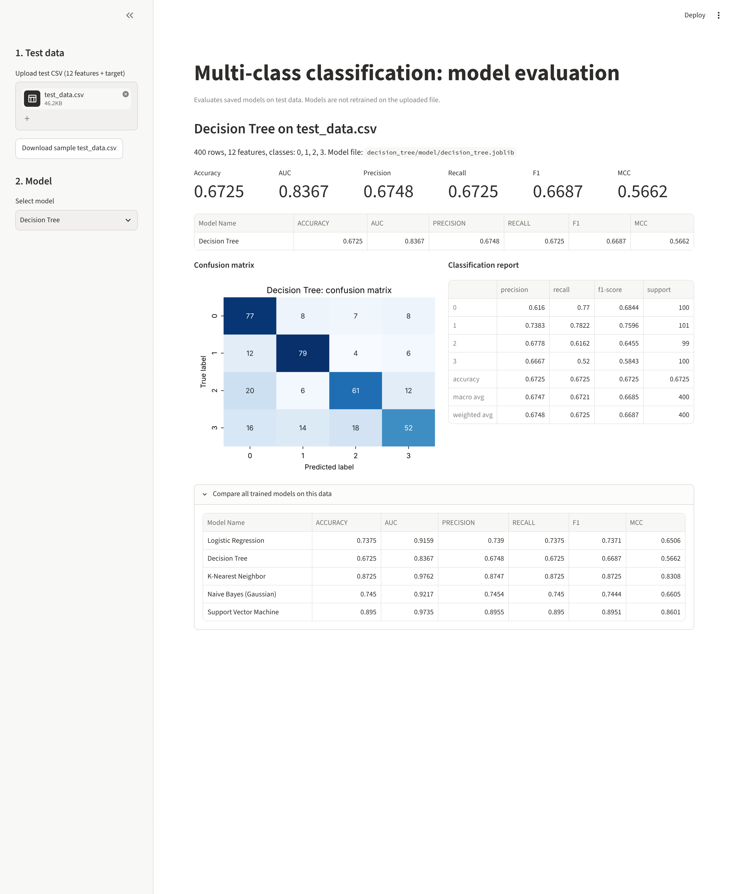
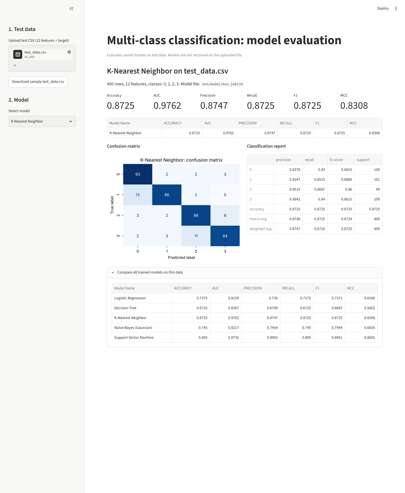
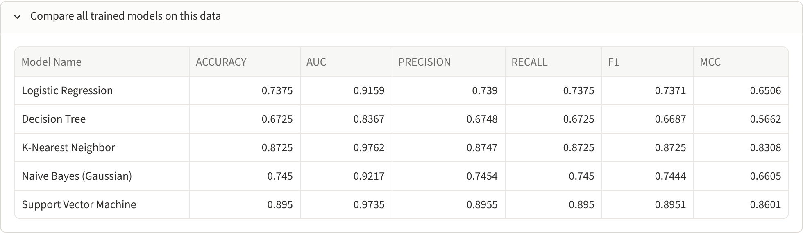

# Multi-class Classification with Five ML Models

## a. Problem statement

Build five classification algorithms, compare them on the same multi-class dataset, and score each one on six metrics: Accuracy, AUC, Precision, Recall, F1 score and Matthews Correlation Coefficient (MCC). The trained models are saved to disk and served through a Streamlit app. The app loads a saved model, scores an uploaded test CSV and shows the metrics, the confusion matrix and the classification report, without retraining on the uploaded data.

The project is organised for learning: every model has its own folder with its own data generator and a model script that runs in three steps (clean, train, test). Each model can be studied independently of the others.

## b. Dataset description

The dataset is synthetic. It is generated in Python with scikit-learn's `make_classification` by `generate_data.py`. Each model folder has an identical copy of this file. The model script calls it during its train step, so no dataset file needs to exist beforehand. Generation uses a fixed seed, so all five models learn from exactly the same data.

| Property | Value |
|---|---|
| File | `<model folder>/data/dataset.csv` (written by the train step) |
| Instances | 2000 (class counts 498 / 505 / 497 / 500) |
| Features | 12 numeric, continuous features, `feature_1` ... `feature_12` |
| Informative / redundant / repeated features | 10 / 1 / 0 (the remaining 1 is noise) |
| Target column | `target`, 4 classes: 0, 1, 2, 3 |
| Clusters per class | 2 (each class is made of two separate blobs) |
| Class separation | `class_sep = 1.2` |
| Label noise | 3% of labels randomly flipped (`flip_y = 0.03`) |
| Random seed | 42 |

The row count and number of classes can be changed with `--rows` (at least 600) and `--classes`.

**Train/test split:** a stratified 80/20 holdout split (`random_state = 42`), giving 1600 training rows (`data/train_data.csv`) and 400 test rows (`data/test_data.csv`) in each model folder. Because the seed is the same, all five folders produce the same split. A copy of the test split is kept at the project root as `test_data.csv`, which the Streamlit app uses by default. The split method (`stratified` or `random`) and test size are set in the `split_data()` method, or with `--split` and `--test-size`.

## c. GitHub repository link

_Add your repository URL here, for example `https://github.com/<your-username>/Assignment2_ml`._

## d. Models used

| # | Model | Folder / script | Configuration |
|---|---|---|---|
| 1 | Logistic Regression | `logistic_regression/logistic_regression.py` | Multinomial, L2, `C=1.0`, lbfgs solver, with StandardScaler |
| 2 | Decision Tree Classifier | `decision_tree/decision_tree.py` | Gini, `max_depth=10`, `min_samples_leaf=5`, no scaling |
| 3 | K-Nearest Neighbor Classifier | `knn/knn.py` | `k=7`, distance-weighted votes, Euclidean, with StandardScaler |
| 4 | Naive Bayes Classifier (Gaussian) | `naive_bayes/naive_bayes.py` | GaussianNB. Multinomial NB is not suitable because the features are continuous and can be negative |
| 5 | Support Vector Machine | `svm/svm.py` | RBF kernel, `C=1.0`, `gamma='scale'`, with StandardScaler. Probabilities for AUC come from `CalibratedClassifierCV` (sigmoid, 5-fold) |

**How the metrics are calculated (multi-class):** Precision, Recall and F1 are weighted averages over the four classes. AUC is the weighted one-vs-rest ROC AUC computed from `predict_proba`. Accuracy and MCC are computed directly over all classes.

## e. Comparison table

Results of the test step on the 400-row test set:

| Model Name | ACCURACY | AUC | PRECISION | RECALL | F1 | MCC |
|---|---|---|---|---|---|---|
| Logistic Regression | 0.7375 | 0.9159 | 0.7390 | 0.7375 | 0.7371 | 0.6506 |
| Decision Tree | 0.6725 | 0.8367 | 0.6748 | 0.6725 | 0.6687 | 0.5662 |
| K-Nearest Neighbor | 0.8725 | **0.9762** | 0.8747 | 0.8725 | 0.8725 | 0.8308 |
| Naive Bayes (Gaussian) | 0.7450 | 0.9217 | 0.7454 | 0.7450 | 0.7444 | 0.6605 |
| Support Vector Machine | **0.8950** | 0.9735 | **0.8955** | **0.8950** | **0.8951** | **0.8601** |

Training accuracy (printed by the train step) compared with test accuracy:

| Model Name | Training accuracy | Test accuracy |
|---|---|---|
| Logistic Regression | 0.778 | 0.738 |
| Decision Tree | 0.874 | 0.673 |
| K-Nearest Neighbor | 1.000 (with distance weighting every training row is its own nearest neighbour) | 0.873 |
| Naive Bayes (Gaussian) | 0.778 | 0.745 |
| Support Vector Machine | 0.938 | 0.895 |

## f. Observations

| MODEL NAME | OBSERVATION ON MODEL PERFORMANCE |
|---|---|
| Logistic Regression | Moderate performance (accuracy 0.74, MCC 0.65). It can only draw linear boundaries, and each class here is made of two separate clusters, so a single straight cut per class cannot isolate them. Training and test accuracy are close (0.78 vs 0.74), so it underfits rather than overfits. Its AUC of 0.92 is far above its accuracy, which means its probability ranking is good even when its top prediction is wrong. Class 0 is the easiest (F1 0.80) and class 3 the hardest (F1 0.66). |
| Decision Tree | The weakest model on every metric (accuracy 0.67, AUC 0.84, MCC 0.57). Axis-aligned splits approximate the oblique cluster boundaries poorly. The gap between training accuracy (0.87) and test accuracy (0.67) shows clear overfitting, even with `max_depth=10` and `min_samples_leaf=5`. Its probability estimates come from leaf counts, which explains the lower AUC. Its strength is interpretability, not accuracy. |
| K-Nearest Neighbor | Second best (accuracy 0.87, MCC 0.83) and the highest AUC (0.976). The data is low-dimensional, dense and scaled, so local neighbourhoods follow the multi-cluster class structure well. Distance-weighted votes with k=7 smooth out the 3% label noise. F1 is balanced across classes (0.86 to 0.89). Every prediction compares against all training rows, so it would slow down on large data. |
| Naive Bayes (Gaussian) | Slightly better than Logistic Regression (accuracy 0.745, AUC 0.92), and the fastest to train. It assumes each feature is an independent single Gaussian per class, which this data violates: the features are correlated and every class is bimodal. Even so, the per-class Gaussians capture enough structure to rank classes well. Training and test accuracy are close, so it does not overfit. |
| Support Vector Machine | The best model on five of the six metrics (accuracy 0.895, F1 0.895, MCC 0.86), with an AUC (0.974) just below KNN. The RBF kernel learns smooth non-linear boundaries around both clusters of each class, and it performs nearly equally on every class (F1 0.89 to 0.90). The small gap between training and test accuracy (0.94 vs 0.895) shows it generalises well with default `C` and `gamma`. It is the slowest to train because of the kernel and the probability calibration. |

**Summary:** the non-linear models (SVM and KNN) clearly beat the linear model (Logistic Regression), the model with a strong independence assumption (Naive Bayes) and the axis-aligned model (Decision Tree). This is expected because each class is made of two separated clusters.

## Streamlit app

Run it with `streamlit run app.py`. The app provides:

- **Dataset upload:** upload a test CSV with the 12 feature columns and the `target` column. Missing columns are reported. If nothing is uploaded, `test_data.csv` is used, and a button lets you download it.
- **Model selection dropdown** listing every model that has been trained in its folder. Models that are not trained yet are listed with a "Train missing models" button, which runs that model's script.
- **Evaluation metrics:** Accuracy, AUC, Precision, Recall, F1 and MCC.
- **Confusion matrix and classification report** for the selected model.
- **Comparison table** of all trained models on the same data.

The app loads `<folder>/model/<name>.joblib` and only calls `predict` / `predict_proba`, so models are never retrained on the uploaded file.

## Screenshots

**App on the default test data (Logistic Regression)**


**Model selection dropdown**


**Decision Tree on uploaded test_data.csv**


**K-Nearest Neighbor on uploaded test_data.csv**


**Naive Bayes on uploaded test_data.csv**


**Support Vector Machine on uploaded test_data.csv**


**Comparison of all five models in the app**


## Project structure

```
Assignment2_ml/
├── app.py                         Streamlit app
├── requirements.txt
├── README.md
├── test_data.csv                  test split used by the app (400 rows)
├── screenshots/                   Streamlit app screenshots
├── logistic_regression/
│   ├── generate_data.py           synthetic test-data generator
│   ├── logistic_regression.py     model script: clean -> train -> test
│   ├── data/                      dataset.csv, train_data.csv, test_data.csv
│   ├── model/                     logistic_regression.joblib
│   └── plots/                     confusion_matrix.png, roc_curves.png
├── decision_tree/                 same layout: generate_data.py, decision_tree.py, data/, model/, plots/
├── knn/                           same layout: generate_data.py, knn.py, ...
├── naive_bayes/                   same layout: generate_data.py, naive_bayes.py, ...
└── svm/                           same layout: generate_data.py, svm.py, ...
```

Each model script is self-contained, so you can read one file top to bottom and see the whole workflow for that model. It has one class with three step methods:

| Step | Method | What it does |
|---|---|---|
| 1 | `clean()` | Deletes the previous run's `model/`, `data/` and `plots/` folders |
| 2 | `train()` | Generates the synthetic data, splits it (`split_data()`), saves the train and test CSVs, fits the model, prints training accuracy and saves the model |
| 3 | `test()` | Loads the saved model and the test CSV, predicts, prints the 6 metrics and the classification report, and saves the confusion matrix and ROC curves |

`build_model()` is the only method that differs between the five scripts.

## How to run

The commands below are for Windows (Command Prompt or PowerShell), run from the project folder `Assignment2_ml`. On macOS or Linux, use `python3` and `source .venv/bin/activate` instead.

### 1. Set up the environment (once)

```bat
cd C:\BITS_DOCUMENTS_10JUL26\BITS\SEMESETER_1_DOCUMENTS\ASSIGN_PPrograms\Assignment2_ml

:: create a virtual environment (skip if .venv already exists)
python -m venv .venv

:: activate it  (PowerShell: .venv\Scripts\Activate.ps1)
.venv\Scripts\activate

:: install the libraries listed in requirements.txt
pip install -r requirements.txt
```

### 2. Train and test each model, step by step

Every model folder works on its own. Example for Logistic Regression:

```bat
cd logistic_regression
python logistic_regression.py clean     :: step 1: delete the previous model, data and plots
python logistic_regression.py train     :: step 2: generate data, split, fit, save model\logistic_regression.joblib
python logistic_regression.py test      :: step 3: evaluate the saved model, print the 6 metrics, save plots
cd ..
```

Running the script with no step name (`python logistic_regression.py`) runs all three steps in order. Repeat for the other folders:

| Folder | Command |
|---|---|
| `logistic_regression` | `python logistic_regression.py` |
| `decision_tree` | `python decision_tree.py` |
| `knn` | `python knn.py` |
| `naive_bayes` | `python naive_bayes.py` |
| `svm` | `python svm.py` |

Optional settings for the train step: `--rows 3000`, `--classes 3`, `--test-size 0.25`, `--split random`. For the test step: `--test-data ..\test_data.csv`. `python generate_data.py` only writes `data\dataset.csv`, so you can look at the data on its own.

With the default settings (seed 42), every run produces exactly the numbers in the comparison table above. If you change the settings, the test step prints the new metrics, and you need to update the tables in this README by hand.

### 3. Run the Streamlit application

```bat
:: from the project folder, with .venv activated
streamlit run app.py
```

1. Streamlit prints a local URL (normally `http://localhost:8501`) and opens it in your browser. If it doesn't open, copy the URL into the browser yourself.
2. **Test data:** the app starts with `test_data.csv` (the 400 held-out rows). To use another file, click **Upload** in the sidebar and choose a CSV that has `feature_1` ... `feature_12` and `target`. **Download sample test_data.csv** gives you a file in the right format.
3. **Model:** pick a model from the **Select model** dropdown. The app loads `<folder>\model\<name>.joblib` and never retrains on the uploaded file.
4. The page shows the six metrics, the metrics table, the confusion matrix, the classification report, and a comparison of all trained models on the same data.
5. If a model has not been trained yet, the sidebar lists it under **Not trained yet**. Click **Train missing models**, or run that model's script as in step 2.
6. To stop the app, press `Ctrl + C` in the terminal.

**Troubleshooting**

| Problem | Fix |
|---|---|
| `'streamlit' is not recognized` | The virtual environment is not active, or the requirements are not installed. Run `.venv\Scripts\activate`, then `pip install -r requirements.txt`. You can also use `python -m streamlit run app.py`. |
| PowerShell refuses to run `Activate.ps1` | Run `Set-ExecutionPolicy -Scope CurrentUser RemoteSigned` once, or use Command Prompt. |
| Port 8501 is already in use | `streamlit run app.py --server.port 8502` |
| "The CSV is missing required columns" | The uploaded file needs all 12 feature columns and the `target` column. |
